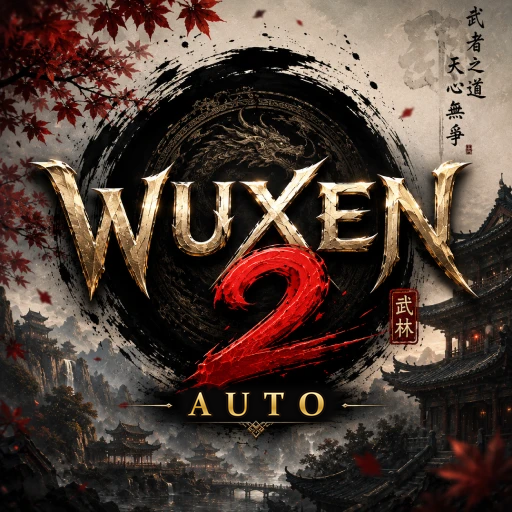

# WuxAuto



A small WPF pilot for the game window `Wuxen2.exe` (TwelveSky2 / Unity port). It captures the
game with the Desktop Duplication API, finds UI elements with OpenCV template matching (through
[Emgu CV](https://www.emgu.com/)) and the built-in Windows OCR engine, and then drives the
**teleport-to-Labyrinth** sequence with input that is addressed to the bound window only.

Everything the pilot does is visible in the app: detections are drawn on the live preview and
every step is logged.

```
bind window  ->  Start (F9)
   open inventory (I)
   click teleportscroll.png
   look for "Labyrinth" in the destination list (OCR); if it is not shown yet,
   click the page chevron (rightchevron.png) and look again, until found
   click "Labyrinth"           <- OCR text match, not a template
   wait for the zone to load
   turn with D until the searchlight beam points north
   wait for the gate          <- fixed delay, template or OCR text
   click mapicon.png (top right)
```

## Requirements

* Windows 10 1903+ / Windows 11, x64.
* .NET 10 SDK (build) or the .NET 10 desktop runtime (run).
* The game must be **windowed or borderless windowed**. Desktop Duplication cannot see
  exclusive-fullscreen windows or protected content, so capture would be black.
* The English OCR language pack (`Settings ▸ Time & language ▸ Language`) is needed for the
  `Labyrinth` text match. Typing the destination name by hand still works without it only if
  `Detection ▸ Compass mode = Template` and `Gate mode = Delay`; the destination step always
  needs OCR.
* If the game runs elevated, run WuxAuto elevated too, otherwise Windows will not let it send
  input to the game.

## Build and run

```powershell
dotnet build .\WuxAuto.slnx
.\src\WuxAuto\bin\Debug\net10.0-windows10.0.19041.0\WuxAuto.exe
```

## Running it on another PC

Do not copy `bin\Debug`: that build needs the .NET 10 Desktop Runtime installed. Instead run

```powershell
.\publish.ps1
```

and hand over `dist\WuxAuto-win-x64.zip` (~76 MB, .NET included). The other PC unzips it
(right-click the zip ▸ Properties ▸ *Unblock* first, or SmartScreen asks "Windows protected your
PC" ▸ *More info* ▸ *Run anyway*) and starts `WuxAuto.exe`.

On start the app checks what it needs from Windows and says plainly what is missing; the report is
saved as `%LOCALAPPDATA%\WuxAuto\logs\startup_check_*.txt` (crashes: `crash_*.txt`):

* **Media Foundation** (`mfplat.dll`, `mf.dll`, `mfreadwrite.dll`) - OpenCV cannot load without it.
  Windows "N" editions: install the *Media Feature Pack* (Settings ▸ Apps ▸ Optional features).
  Trimmed "lite" Windows builds (e.g. Ghost Spectre Superlite) often remove it; then the app
  cannot run there.
* **English OCR** - the app opens but cannot read the game's text.
* Windows 10 older than version 2004 (build 19041) - warning only.

If it dies with no message at all (Event Viewer: *"terminated due to an internal error in the .NET
Runtime"*, exit code `0x80131506`), the .NET runtime itself failed before the app's own checks
ran. Run **`Diagnose.cmd`** from the app folder: it records the runtime's error text (lost on a
double-click), Windows build, CPU and the system DLLs, then retries with runtime features turned
off one by one, and opens the result (`diagnose.txt`) in Notepad.

## Updates (GitHub Releases)

Source and releases: <https://github.com/atherosxd/WuxAuto>. Every copy of the app asks the GitHub
API for the latest release when it starts (and on **Check for updates** at the top of the window).
A newer version shows a green bar with **Install now** and, on start, a Yes/No question with the
release notes. Installing downloads `WuxAuto-win-x64.zip` to `%TEMP%\WuxAuto-update`, closes the
app, copies the files over the app folder (`robocopy /E`: files that are only in the app folder
stay) and starts it again; the copy log is `%LOCALAPPDATA%\WuxAuto\logs\update_*.log`. Settings,
templates, logs and snapshots are in `%LOCALAPPDATA%\WuxAuto` and are not touched. Installing is
refused while the pilot runs, from a build folder (`bin\Debug`, no `coreclr.dll`) and from a folder
the user cannot write to.

To publish a version (from `main`, committed and pushed, `gh` logged in):

```powershell
.\release.ps1 0.3.0 "What changed, in one line"
```

It builds the zip with that version stamped in (`publish.ps1 -Version`) and creates the release
`v0.3.0` on the current commit with the zip (GitHub makes the tag). The version lives in the tags; the
`<Version>` in the project file is only what a local build shows.

## Using it

1. **Bind.** Pick the `wuxen2.exe` entry in the process list (use *Refresh list* if you started
   the game after the app) and press **Bind / Unbind**. The preview fills with the captured game
   area and the log reports the client size.
2. **Check the detections.** Leave the game on the inventory screen and press **Test scan now**.
   The preview draws a box around every template hit, the OCR region and the compass region, and
   the log lists what was found with scores and timings. Anything misaligned means a built-in
   region default needs to change in code (regions are no longer editable, see below).
3. **Start.** Alt-tab out of the app so the game is in front, then press **F9** (or click Start
   and let the pilot bring the game forward). **F10** is the panic key: it stops the pilot and
   unbinds. **F11** saves the current frame (with the detections drawn on it) to
   `%LOCALAPPDATA%\WuxAuto\debug\` - that is the quickest way to capture the gate banner, the map
   window or a monster marker without alt-tabbing out of the game. "Dry run" runs the whole
   sequence with detections but without sending any input, which is the safest way to check the
   thresholds first — note that with dry run on the pilot *never touches the game*, so a
   "nothing happens" run is usually dry run still being ticked.
4. Tune, repeat. Settings are applied live and saved to
   `%LOCALAPPDATA%\WuxAuto\settings.json` when the app closes. Every log line is also written to
   `%LOCALAPPDATA%\WuxAuto\logs\wuxauto_<start time>.log`, and `WuxAuto.exe --autostart` binds
   the game window and presses Start by itself.

   **Screen positions are never saved.** The search regions and the click fractions (map wheel
   point, row `>` column, boss-select click) are rebuilt from the built-in defaults at the start
   of every run (Start and every looped run), and the learned template scales are dropped so they
   are re-learned at the current window size. The log says so:
   `Screen positions reset to the built-in defaults for the WxH client; ...`. This lets the game run
   at any resolution without a stale saved position getting in the way. The file carries a
   `Version`; an older file that still contains positions is rewritten without them on load.

The Wuxen2 flow this drives:

| Step | Interaction |
| --- | --- |
| Game settings | once per Start, in town: `Escape` opens the game's SETTINGS → `VISUAL` tab → **Font size** is kept within `Sequence ▸ FontSizePercent` … `FontSizeMaxPercent` (110 … 120 %) → the list is scrolled down to **TAB target**, which is set to `Default` with its left arrow (`Sequence ▸ TabTargetDefault`, the "TAB target: Default" check box) → **SAVE** once if either changed → `Escape`. Only buttons read by OCR are clicked; anything unexpected closes the window and the run carries on (`fontsize_unread` / `tabtarget_unread` snapshots) |
| Autohunt off in town | in town, before every teleport (also after a restart, a closed stage 5, the LOD timer or a re-login): the autohunt key is tapped and the combat log on the left is read — a new **Auto hunt ended** line = it was on and is off now; **Auto hunt started** = it was off, so the key is tapped again. No line within 2 s → one more tap (two unread taps leave it as it was), then a warning + `autohunt_unread` snapshot and the run carries on. `Sequence ▸ AutohuntOffInTown`, the "Autohunt off in town" check box |
| Run skill on in town | in town, before every teleport: the Run skill must be on. Its icon (`runskill.png`) is found on the skill bar; an active skill has a gold ring round it. No ring → the icon is clicked (up to 3 times, checked after each). Icon not found → the **Run key** (default `W`, the slot you put Run in) is tapped once per Start — it is a toggle, so it is never pressed blindly twice. |
| Inventory | taps `Input ▸ Inventory key` (default `I`) |
| Teleport scroll | **right click** the `teleportscroll.png` match - in this client a left click only picks the item up and a double click does nothing |
| Destination list | OCR of `Sequence ▸ Regions ▸ Teleport list` for `Destination text` (default `Labyrinth`, which matches `[The Labyrinth (Adept)]` on page 2), paged with `rightchevron.png` when it is not on the visible page |
| Destination | left click the matched text row |
| Gate open | matches `dungeongateopen.png` (`Dungeon ▸ Gate template`), with an OCR pass over the same region for `DUNGEON GATE OPENED` every few polls as a fallback. `Dungeon ▸ Gate to map delay` (3 s) then lets the kill animation and the walk to the gate finish |
| Map | left click the `mapicon.png` match (the button in the minimap header). If the window does not appear within `Map open delay` + one confirmation poll, the button is clicked again (up to `Dungeon ▸ Map reopen retries`, 3). "Open" means the list's "Spawns" header reads and a row `>` is on screen; nothing in the list is clicked without it - if you move or click the mouse yourself while the map opens, the pilot reopens the map instead of clicking where the list would have been |
| Stage name | OCR of `Regions ▸ Map boss list` for `Dungeon ▸ Stages[n]`. If the name is not on the visible page the list is paged **down** (the map always opens at the top): the arrows above the "Spawns" column are located as the light glyphs in the band just above the OCR'd "Spawns" header, so no template or fixed pixel offset is involved; the rotated `downchevron` template is the fallback and the wheel over the list the last resort. `Regions ▸ Map scroll` is deliberately a tall band (0.09-0.37 of the height) because the map window is not laid out proportionally across resolutions |
| Next stage | left click the **boss name** first (the game highlights that row), then click the `>` of the highlighted row using `rightchevronfoc.png` (`Dungeon ▸ Row chevron template`, threshold `Row chevron score` 0.55). The map closes by itself. If the chevron is not matched it retries 3 times, then falls back to colour / template-column / name-click; if the map is still open after the chevron click it repeats, and if the name never turns up the map is reopened and the search retried. If the map is gone before the `>` was clicked (the name click only highlights the row), something else closed it - the map is reopened instead of waiting for a boss that was never picked |
| Boss spawn | after `Dungeon ▸ Boss spawn wait` (60 s), taps `Dungeon ▸ Tab key`, then looks for `monstericon.png` in `Regions ▸ Monster icon` or the stage name anywhere in `Regions ▸ Boss name`. `Dungeon ▸ Autohunt key` (`J`) is tapped here too, right after the spawn wait, only with "Hold skill before autohunt (stages 1-4)" off (or no skill key / `Hold skill` 0) |
| Select boss | once the boss has been visible for `Boss select delay` (2 s): with "Hold skill before autohunt (stages 1-4)" on (default) the pilot first **holds the skill key** for `Hold skill` (3 s; the character runs at the boss and attacks it; then Ctrl + skill key with `Dungeon ▸ CtrlSkill`), then taps `J` (autohunt on) and waits until the combat log has not changed for 1.5 s (at most 6 s) - the hold's last hits print for a second or two after `J`, and one of them landing after the first click would be taken for the selection. Then it left clicks the middle of the window - the game's autohunt will not attack until the boss is selected. After each click it OCRs `Regions ▸ Attack message` (left side) for `Dungeon ▸ AttackConfirmText` (`Attack succeeded`, as in the combat log's `Attack succeeded!Normal damage(+N)`) for `AttackConfirmMs` (1.2 s); the log is usually full, so a hit is any change in the visible lines (text + damage number). If nothing changes it clicks the next point: centre, then 8 points one `BossSelectStep` (6 % of the client height) out, then 8 points two steps out, up to `BossSelectMaxTries` (17). Gives up with a warning and an `attack_s<N>` snapshot, then watches the boss anyway. Empty `AttackConfirmText` = one centre click, no check |
| Boss dead | the "DUNGEON GATE OPENED!" banner appears (checked every `Gate poll`, 0.5 s, while the boss is up - only a *new* banner/line counts), or the boss name/marker has been missing for `BossGoneMs` (10 s) without a break (checked every `Boss poll`, 2 s; the name flickers away while the boss is off camera, so short gaps do not count). A banner seen here opens the map for the next stage straight away; after the last map stage it goes on to the searchlight and the run to the last boss. If the banner is missed between stages, the map is opened anyway after `GateFallbackMs` (15 s) - unless the previous boss is still on screen, then it goes back to watching it |
| Searchlight | after the last stage: the labyrinth always loads at the same camera angle, so the pilot taps `Dungeon ▸ Rotate left key` (`A`) for `RotateStepMs` (120 ms), waits for the camera to settle and scores `flashlight3.png` (a straight-up beam; `Dungeon ▸ FlashlightTemplate`; a PNG with transparent areas is cropped to its beam automatically) after every tap. Once the score passes `Dungeon ▸ Flashlight score` (0.85) it keeps turning in half taps while the score still rises, and when it starts falling it undoes the extra taps with `D` - so it stops at the best heading, not at the first one above the threshold (which was north-north-east). The searchlight box is placed under the minimap's `x , y` line (found by OCR in `Regions ▸ Minimap`), because the minimap panel keeps its pixel size instead of scaling with the window. After 60 taps without a match it taps back with `D` to the best heading seen (if it scored at least 0.60) |
| Run | read the `x , y` label under the minimap (`Regions ▸ Coordinates`), probe one click straight up and one click up-right to learn how screen clicks map to world coordinates, then steer with clicks in the **upper part** of the window (the camera faces north, so up is forward; only an overshoot clicks below the centre) through the `Dungeon ▸ Route` points first (default `3603,1973`, straight north after stage 4 - the diagonal hits a wall) and then to `Dungeon ▸ Target X/Y` (3325, 1932 - the last boss, which cannot be picked on the map) within `Target tolerance` (30). |
| Disconnect | every 5 s the pilot looks for the `SERVERS` screen; if it shows, it logs back in by clicking **Online → CONNECT → LOG IN → OK → START GAME** (800 ms apart, `Sequence ▸ AutoReconnect` / `ReconnectStepDelayMs`), waits for Piercing City and starts the run again. It only clicks buttons - the game must remember the account |
| On arrival | right after the labyrinth's loading screen the pilot zooms out (Ctrl + mouse wheel down, `Dungeon ▸ ZoomOutNotches` 15) and faces north straight away (`Dungeon ▸ NorthOnArrival`), so after stage 4 the camera already looks at the gate. Turning uses 180 ms taps (`RotateStepMs`) |
| Gate aim | after facing north the pilot tilts the camera up (right-drag upwards, 150 px), looks for the next stage's red/orange background straight ahead and clicks the brown floor just below it, then lets the character walk before steering by coordinates. Saves a `gate_view` snapshot each time. Off by default (the coordinate run is used); `Dungeon ▸ AimGate` turns it on |
| Stage 5 | at the last waypoint (3603,1973) the pilot first makes sure the autohunt is **off**: the newest "Auto hunt started / ended" line in the combat log decides, and `J` is only pressed when it reads started (or when no line shows, as in town). Then Tab until `Dungeon ▸ FinalBoss` (`Sacred Sky Lord`) shows. With the boss in view it attacks by hand at once: the skill key is **held down** for `Hold skill` (3 s - the character runs at the boss and keeps attacking), then tapped `Manual attacks` more times (10, at least `Attack gap` 300 ms apart; 11 presses in all). Every press ends with Ctrl + skill key (`1`, then `Ctrl+1`; `Dungeon ▸ CtrlSkill`, below). A new "Attack succeeded" line must follow the last press (checked 0.5 s after it; none → more taps, up to three times as many); still nothing → Tab and another round of hold + taps (3 rounds; nothing is clicked while the autohunt is off), then back to Tab with the autohunt still off (`nohit_s5` snapshot). After the hit the autohunt goes on (`J`), the pilot waits 1 s for the manual attacks' last hits to pass, and then - because `J` drops the target - clicks on the boss round the middle of the window like on stages 1-4 until a new "Attack succeeded" shows (one click per 1.2 s, up to 17); none → `J` turns the autohunt off again and the hold + taps repeat (same 3 rounds). The magenta selection ring is no longer read (it was reported missing with the ring plainly on screen). While watching the fight, no new "Attack succeeded" for 15 s (`Dungeon ▸ AutohuntStallMs`) with the boss still up means the autohunt is not attacking it: `J` off, Tab and the whole attack again (`stall_s5` snapshot). After the kill it presses `J` once (autohunt off) and uses the teleport scroll to go to `Dungeon ▸ ReturnDestination` (`Piercing City`); with `Loop` on, the next run starts from there |

### Dungeon stages

`Dungeon ▸ Stages` holds the boss name of each stage, in order: `Sanctified Unicorn`, `Spectral`,
`Sundersword`, `Ragesoul Heathen`. The pilot logs which stage it believes it is on, warns when the
map shows a different name, and after the last stage it does the searchlight/run-to-coordinate
finish. Behind the gate text is a banner cropped by the user, so `dungeongateopen.png` is expected
in `%LOCALAPPDATA%\WuxAuto\templates` (or `Assets`) - if it is missing the pilot falls back to OCR.

### Zone guard and the Bohai Outpost dialog

Everything Labyrinth-related (gate wait, map clicks, boss Tab/select, turning north, the final run)
only runs while the minimap title says **The Labyrinth**; the title is read every 2 s. Not seen for
6 s → the pilot holds all input; back in `Piercing City` → it starts the next run; another zone
(e.g. Bohai Outpost) → snapshot `wrong_zone` and the next run - but only while the game window is in front: behind another window (a second game client, this chat) the capture shows that window, and the pilot just waits. If the **Bohai Outpost** dialog shows
(`Sequence ▸ CancelDialogText`, default `Bohai`), its `Cancel` button is clicked.

### Auto confirm (selling items)

While the game is bound and the pilot is **not** running, **Ctrl + right click** an item: the
game's confirm dialog (`... Confirm to use?` / `... Confirm to sell?` over CANCEL / OK) is read on
every frame and its **OK** is clicked the moment it shows (about 0.2 s). A plain right click leaves
the dialog to you. The watch lasts 3 s per Ctrl + right click, so a selling spree with Ctrl held
just keeps going. The check box "Auto confirm (Ctrl + right click)" turns it off; `Sequence ▸
AutoConfirmText` (`Confirm`) is the word that marks the dialog and `AutoConfirmButton` (`OK`) the
button - read as text, or found as the lowest gold button under the message (OK and USE ALL are
gold, CANCEL is dark). The first dialogs of each app start are saved as `autoconfirm` snapshots.

### Auto War (Bohai Outpost tribe wars)

Pick **Auto War** (Mode buttons above Start; **War** in the mini window) for an alt that should join every
Bohai Outpost war: it waits in a cave, goes in when the war opens, buffs and fights, and when the game sends it
home it teleports back to the **same cave and the same monster**, turns the autohunt on and waits for the next war.

1. Put the character in the cave you want it to hunt in. That cave must be on **page 3** of the teleport scroll
   (setting `War > ListPage`), and the autohunt on. Bind the game, pick **Auto War**, press **Start**.
   Starting it inside **Bohai Outpost** during a war works too: it fights right away. With no cave saved yet it says so
   and waits in town for the next war afterwards - start it once inside the cave so it remembers where to go back to.
   **Starting it in a home town** (Piercing City, Molten City, Wandering City) also works: it waits there for every
   war, joins it, and after the war just waits in town again - no cave trip and no autohunt (a saved cave is left as
   it is, for a Start in the cave). Not tested live yet.
2. At Start the pilot checks the screen and stops with a message (it never guesses) when: you are not in a cave; the
   cave's name could match **two** entries on page 3; the monster cannot be confirmed in the map's monster list (the row
   must carry the whole name - "Goblin" is never the "Goblin Elite" row - and only one row may); or a war key (skill,
   target, autohunt, inventory) is not set, or a key that is set (Shura too) is not a key it can press.
   The buff icons and **Shura** are **optional**: the ticked buffs and the Shura icon (when the Shura key is set) are
   looked for on the skill bar, and the missing ones are only a warning with their best scores - the buff rounds skip
   them. With no Shura key the fight skips the Shura hold.
3. It then reads the time to the next war from **Menu (the button at the top centre) > Tribe Status**, closes those
   windows, waits, and 10 s before the war (`Lead time`) turns the autohunt off and clicks OK on the war dialog.
   Inside it sets the game's TAB target to **Enemy worth CP**, buffs - auto-buff key `O`, or else the buff icons and then
   the weapon buff icons one by one; then the **item buffs** on the skill bar either way (they use an item; with `O` they
   are still clicked) - again every 5 min 45 s, then repeats: Tab to an enemy, the X buff, hold Shura, attack until the
   target is gone. An enemy counts as targeted when its name reads in the target box at the top centre (a player's
   **red** name has its own read) or, name unread, when its HP bar's numbers ("49293/49293") show there.
   **Out of the respawn point:** once the war has started (not while everyone waits at the closed gate), after 5 Tabs
   in a row without a target it Ctrl+clicks (a walk) toward the nearest name tag on screen, a quarter of the screen
   height at most per step, then Tabs again. It looks in the game world between the game's panels: from about 31 % to
   80 % of the width at the character's height, more higher up; never at its own tag (within 22 % of the screen
   height of the character), the top strip, the combat log (left, 0-31 % wide, 13-56 % high), the chat and bottom bar
   under it, the pet and minimap panels, the event notices, the item list or the skill bar. Combat-log lines, boss
   speech and system notices are never taken for a name, and nothing is while a window (map, inventory, teleport
   scroll, settings) is open. A word that stays at the same spot after a step is a window or
   a chat line: it is ignored for the rest of that war. At most 6 steps, then Tab only for 20 s; 3 looks without a
   name tag in view also mean 20 s of Tab only; at most **18 steps per war** until a target is seen, then Tab only.
   Only while the minimap shows Bohai Outpost. Not seen in a live war yet.
   It watches the HP numbers (top left) and rebuffs after a death. When the war is over it goes back as above - at most
   3 times in 30 min without a war in between (a cave that keeps sending the character to town would otherwise cost a
   teleport every round); then it stops.
4. Safety: it never clicks a guessed spot to close a window (a window whose X it cannot read stays open, with a
   warning); every war step that reads the screen waits while the game window is behind another window (a second game
   client's war dialog, map or combat log is never taken for its own) - only the teleport-scroll steps and logging back
   in keep reading then, and they cannot send anything until the game is in front; the Bohai dialog is never cancelled
   in this mode. One game per WuxAuto - do not run it next to a Laby / LOD client on the same PC. It does not walk
   inside Bohai.
5. Settings (Settings panel > Auto War): **Shura hold (ms)**, **Rebuff every (ms)**, **Lead time (ms)**, **TAB target**,
   **Buffs**, and the read-only **Back to** line (the saved cave and monster). The rest is in `settings.json` under `War`.
   **Buffs** has one check box per buff (10), with its icon and, in its tooltip, its template file:
   **Buff 1**-**Buff 5** (`warbuff1`, `warbuff3`, `warbuff4`, `warbuff5`, `warbuff6`; `War > BuffIcons`),
   **Weapon 1 (sword)**, **Weapon 2**, **Weapon 3** (`warbuff2`, `warweapon1` - white-gold lightning around armour,
   `warweapon2` - blue swirl; `War > WeaponBuffIcons`: a character uses one weapon, so usually only one of them is on its
   bar) and **Item 1** / **Item 2** (`waritem1` - light scroll with a glyph, `waritem2` - blue scroll: items placed on the
   skill bar; `War > ItemBuffIcons`). All
   are ticked at first; untick the ones this character does not have: an unticked buff is never clicked and not looked for
   at Start (`War > DisabledBuffs` in `settings.json`). The X buff is **Buff 3** (`warbuff4`): unticked, it is not
   clicked in the fight either. A template that has no PNG yet is named as such in the warnings
   ("no <name>.png in templates/Assets").

**Upgrade note:** once Auto War is chosen, `settings.json` holds `"Mode": "AutoWar"`, which a WuxAuto from before Auto War
cannot read - it starts with the default settings and saves them on close, and your Laby / LOD settings are gone. On a PC
where an older copy shares `settings.json` (`%LOCALAPPDATA%\WuxAuto`), update every installed copy first, then choose Auto War.
Settings v23 only takes `warbuff2` (the sword's buff, a weapon buff now) out of a saved `War > BuffIcons`; the weapon and
item lists and the check boxes are new settings a v0.19.0 copy does not know - it checks the five remaining buffs at Start,
and when it saves `settings.json` the check box choices are lost (all ticked again). Update every copy.

**Not verified yet - no live war has been run.** Everything inside Bohai (the minimap title, "Gate is Open", enemy
players in the target box, HP 0 and the revive), the buff icons on a real skill bar (the weapon and item buffs included), the Menu close geometry and whether
the menu button toggles it shut, the "Regular War" label in the autohunt settings, and the "Arrived:" wording. Every part logs
what it saw and saves `war_*` pictures to the debug folder the first time, so send the log and those pictures after the first war.

### Auto Blossom (Jaso Practitioners in Blossom Garden)

Pick **Auto Blossom** (**Blossom** in the mini window) and press **Start** in a home town (or inside Blossom Garden).
Blossom Garden needs no key.

1. In town, the game's Settings: TAB target **Nearest monster** (`Tab` then reaches monsters further away). Then the
   teleport scroll, page 1, **Blossom Garden**; the zoom-out waits for "Blossom Garden" on the minimap.
2. Buffs - the Auto War way: autobuff (`O` + the ticked item buffs) when the item list shows "[Auto buff scroll]",
   else the ticked buff icons (Settings > Auto War > Buffs).
3. `D` taps (100 ms) until the two pillars stand side by side with their midpoint at the centre of the screen
   (`Assets\blossompillar.png`, a pillar base; the user's frame scores 0.98 and 0.81, the score gate is 0.70). Not lined up
   after 15 taps or 10 s: it walks anyway. Started inside Blossom Garden there is no turn: it walks from the nearest waypoint
   and learns the camera's direction from the first steps.
4. The walk: 17 waypoints (`Blossom > Waypoints` in settings.json) - 1 to 5 once, then 6 to 17 over and over - starting at
   the nearest one. The first click goes straight up the screen; where the character went tells which way the camera
   looks. It stays on the line between two waypoints (lay them along the road) and clicks every 0.35 s so the character keeps running, and reads the coordinates about once a second. When it
   leaves a waypoint it can turn the camera - Settings > Auto Blossom > **Camera turns**, default `1:A5, 2:D5, 3:A5, 4:D5`
   (`1:5A` works too: after waypoint 1 tap `A` five times, after waypoint 2 `D` five times, ...) - and learns the camera's
   direction again from the next step. **Walk back the same way** (Settings > Auto Blossom): after the last waypoint the
   route is walked back to the loop start (83, 82 ... 1), then forward again, with the camera turns undone on the way back.
   `Tab` every second. At a reached waypoint it stands at most **Waypoint pause** (3 s; at most 5 s - the AFK
   checker kicks idle characters to town, and from town it teleports back in).
5. **[S]Jaso Practitioner** in the target bar (or a target showing the chest): the skill key held down (**Hold skill
   (Blossom)**, on; off = tapped every 0.3 s; Ctrl + skill as LOD) until the target is gone 1 s, looting all the while (**Loot while fighting**; off = 1 s later the loot key every 0.2 s for
   **Loot time**), then on to the waypoint it was heading for. Only a monster at full health is attacked (one another player
   is hitting is left alone). No move and no new "Attack succeeded" line for 5 s while a target is selected (something in
   the way): it zooms out, lets go of the skill and steps aside - right, left, back, then the diagonals - until it moves.
   The chat's "[AFK Checker] ... 1/5" (or more): a short step another way. A fight that never ends is given up after 2 minutes (then targets are ignored for 10 s). Blocked (a
   railing, the bridge): it zooms out again and steps right, left, back, then the diagonals, zooming out again each round,
   until it moves; a waypoint it gets no closer to in 15 reads is skipped. A waypoint counts as reached within 40 units (it slows down and homes in on the last 300), or when blocked within 150 of it. Started inside Blossom Garden,
   it first makes sure the autohunt is off.
6. Rebuff when **Rebuff every** (Auto War) is due - after a loot or at a waypoint, never mid-fight.

**Record your own route** (Settings > Auto Blossom): bind the game, stand at the arrival spot in Blossom Garden lined up on
the pillars, press **Record route** and walk the road by hand. A waypoint is saved every 120 units, and your own `A` / `D`
camera taps are saved with the waypoint you are at (the pilot taps the same way when it leaves it). Press **Loop starts
here** where the endless loop begins, and **Stop recording** at the end of the loop (back near the loop start). The route
replaces the waypoints, the loop start and the camera turns; a copy goes to `%LOCALAPPDATA%\WuxAuto\blossom-route.txt`.
A road that does not come back to its start (the end more than 400 from it) gets **Walk back the same way** ticked.

Same upgrade note as Auto War: an older WuxAuto cannot read `"Mode": "AutoBlossom"` and resets the settings - update every copy first.
Probe: `--pillars <dir>` prints the pillar hits and the lined-up verdict per PNG. **Not tested live yet**: which way `D`
turns the view, walls between waypoints, the Jaso's name in the target bar.

### Input safety

By default (`Input ▸ Mode = ForegroundSendInput`, `Only while game is focused`) the pilot sends
input **only while the bound HWND is the foreground window**. If anything else takes focus, the
action is suppressed, the reason is logged, and the pilot retries once the game is back in
front — so keystrokes can never land in another app. `BackgroundMessages` posts window messages
straight to the bound HWND instead; it works for some Unity builds and does nothing for others,
but it also only ever talks to the bound window.

## Settings that matter

| Setting | Meaning |
| --- | --- |
| `Detection ▸ Icon score` | Minimum score (0–1) for `teleportscroll` / `rightchevron` / `mapicon`. Raise it if the pilot clicks the wrong thing, lower it if it cannot find the icon. |
| `Detection ▸ Compass score` | Minimum score to trust the beam template. |
| `Detection ▸ North tolerance°` | Stop turning when the compass is within this many degrees of north (default 8). |
| `Detection ▸ Compass mode` | `Template` (rotated `flashlight.png` matching, recommended), `Brightness` (moment-based fallback, no template needed, ~±20°), `Auto`. |
| `Sequence ▸ Rotation` | `Key` (holds `D`/`A`, auto-calibrates degrees per second) or `MouseDrag` (right-drag, auto-calibrates degrees per pixel). |
| `Sequence ▸ Gate mode` | `Delay` (wait `Gate delay ms`), `Template` (needs `gateopen.png`), `Text` (OCR looks for `Gate text`, default "open"). |
| `Regions` | Every region is `x, y, width, height` as fractions of the client area, so one profile works at any resolution. Not editable and not saved: rebuilt from the defaults at every run. |
| `Sequence ▸ Dry run` / `Loop` | Detect without input; repeat the sequence. |
| `Sequence ▸ TabTargetDefault` | On (default): on Start in town the game's Settings ▸ VISUAL ▸ TAB target is set to `Default` and saved. Off = leave it alone. |
| `Dungeon ▸ HoldBeforeAutohunt` ("Hold skill before autohunt (stages 1-4)") | On (default): on stages 1-4 the autohunt (`J`) only goes on after one held skill press on the boss in view (`Hold skill`, 3 s), then the select clicks as before. Off = `J` right after the spawn wait, before Tab. No skill key or `Hold skill` 0 = off. |
| `Dungeon ▸ CtrlSkill` ("Ctrl + skill key too") | On (default): every manual skill press — Laby stage 5 (the held press and the `Manual attacks` taps), the stages 1-4 held press and the Auto LOD skill spam — sends the skill key and then Ctrl + skill key (`1`, then `Ctrl+1` about 60 ms later). With "Hold skill (LOD)" the held key is let go for a Ctrl + skill tap every `Lod ▸ SkillEveryMs` (0.3 s) and then held again. Off = the plain skill key only. |
| `Lod ▸ RingCheckEveryMs` / `RingStayMax` | 3000 / 1.0: with "Walk up to the boss (LOD)" on, after the first walk up of a fight the pink ring round the boss's feet is checked every 3 s; the character further out than 1.0 ring radius (= off the ring) → Shura, Ctrl+click the ring again, attack. A walk that did not get there waits 9 s before the next check. A ring out of view counts as "under the boss" and nothing is done. `RingCheckEveryMs` 0 = only the walk after the first hit. |
| `Lod ▸ WalkToBossSpot` ("Walk to the boss spot (LOD)") | On (default): after the south turn Auto LOD walks forward to `Lod ▸ TargetX/TargetY` (**1199, 1782**; the teleport lands at about 1195, 1578) pressing Tab every `Lod ▸ TabEveryMs` (1.5 s), then waits there tabbing until **Bai Gu Great** shows. Off = stay where the teleport put the character and only press Tab — no walk clicks. The south turn happens either way. Settings v22 turns it on and moves the old 1191, 2413 spot; a spot set by hand stays. |
| `Lod ▸ ShuraKey` ("Shura key (LOD)") | Auto LOD stops the attack with **Shura** before a mid-fight buff and before the walk up to the boss: the `shura.png` icon is looked for on the skill bar (`Regions ▸ Hotbar`, bottom 15 %) and clicked `ShuraPresses` (3) times, `ShuraEveryMs` (200) apart. Not found → this key, the same way (default `E`, the slot Shura is in); empty → `StopAttackKey` (Space) × 15 (buff) / 3 (walk) as before. The same icon in two slots → the leftmost. Auto War: held each fight cycle; empty = no hold. |
| `Sequence ▸ AutohuntOffInTown` | On (default): in town, before every teleport, the autohunt key is tapped and the combat log read (`AutohuntStartedText` / `AutohuntEndedText`, "Auto hunt started" / "Auto hunt ended"); "started" = it was off, so it is tapped again. Off = never touch it in town. |
| `Sequence ▸ AutoConfirmDialogs` ("Auto confirm (Ctrl + right click)") / `AutoConfirmText` / `AutoConfirmButton` | On (default): while the game is bound and the pilot is not running, a Ctrl + right click on the game starts a 3 s watch for a dialog line containing `AutoConfirmText` (`Confirm`); its `AutoConfirmButton` (`OK`: the line reading exactly that under the message, else the lowest gold button under it) is clicked as soon as it shows. Off = never. |
| `Sequence ▸ KillChime` ("Kill chime") / `KillNotification` ("Kill notification") | On (default): a chime / a Windows notification when a Labyrinth boss dies and when an LOD kill's loot step ends (see *Kill alert* below). |
| `Sequence ▸ KillSound` ("Sound: … Choose... / Default") | Empty (default) = the built-in chime (or `templates\chime.wav` if there is one). **Choose...** picks an MP3, WAV or OGG; it is copied into `%LOCALAPPDATA%\WuxAuto\sounds` (an OGG as a WAV) and this holds the copy's path. |
| `Sequence ▸ RunSkillCheck` ("Run skill on in town") / `RunSkillKey` ("Run key") | On (default): in town, before every teleport, the Run skill icon (`runskill.png`, `RunSkillTemplate`) is looked for on the skill bar (`Regions ▸ Hotbar`) at `RunSkillMatchScore` (0.88) or better and the gold ring round it measured (`RunSkillRingMin`: 0.25 of the ring = on). No ring → the icon is clicked, up to 3 times. Icon not found → `RunSkillKey` (default `W`) once per Start. Off = never look. |

### Regions

* `Scroll` – where the teleport scroll icon can appear (default: whole screen).
* `Teleport list` – the chevron buttons; the pilot clicks the one closest to the previous one so
  a list with several arrows does not confuse it.
* `OCR area` – searched for the destination text.
* `Map button` – the top-right map icon.
* `Gate area` – checked for the "gate open" template/text.
* `Map boss list` – the scrollable "Monsters on this map" list (names + row `>`).
* `Map scroll` – must cover the up/down arrows above the "Spawns" column. The arrows themselves
  are located as the light glyphs in the band just above the OCR'd "Spawns" header, not by fixed
  pixels, so the region only has to *contain* that header. The wheel over the list is the last
  resort if neither the header nor the rotated chevron template can be found.
* `System message` – only used to log game notices such as "no walkable path".
* `Attack message` – left side, the combat log, searched for new "Attack succeeded!" lines after each boss select click.
  Generous guess (0, 0.10, 0.40, 0.85) until a frame of the message is measured.
* `Compass` – the box around the searchlight beam on the minimap.
* `Coordinates` – the `x , y` label under the minimap.

**Resolutions.** Every region is a fraction of the client and is reset to the built-in default at
the start of every run (never loaded from `settings.json`), so it follows the window
automatically. Tested sizes: 1024x768, 1366x768, 1440x900, 1600x900, 1920x1080, 1920x1200,
2048x1152, 2560x1440. Templates are searched over a scale range around `client height / 1080`
(×0.70 … ×1.55, step 0.05), and the map row `>` is found with `rightchevronfoc.png` inside the
OCR'd row band (bright-blob fallback), so it needs no scale of its own. If the game's map window
sits somewhere the defaults do not cover, the pilot
tries a generous region, finds the name anyway and logs the coordinates that `Map boss list`
should be widened to.

## Templates

`teleportscroll.png`, `rightchevron.png`, `rightchevronfoc.png`, `mapicon.png`, `flashlight.png`,
`dungeongateopen.png` and `monstericon.png` ship inside `src\WuxAuto\Assets`. A file with the same
name in `%LOCALAPPDATA%\WuxAuto\templates` wins, so templates can be re-cropped without a rebuild.

Detection is resolution independent: the first search for a template runs over a **scale range
around the `client height / 1080` guess (×0.70 … ×1.55, step 0.05)**, the winning scale is
remembered per template **and per client height**, and later frames use the fast single-scale
path. A template cropped at 900p, 1080p or 1440p therefore all work, and switching resolution
re-learns automatically. `Detection ▸ Template score` defaults to a deliberately loose **0.70**;
the scale search does the real work, the score only filters obvious non-matches. If a detection
fails, the failure message reports the score of the closest look-alike so you can tell "raise the
threshold is not the issue" from "re-crop this template".

Drop your own crops with the same file names into

```
%LOCALAPPDATA%\WuxAuto\templates
```

and they take priority over the shipped ones — this is the intended way to re-crop
`flashlight.png` for your resolution/graphics settings, or to add `gateopen.png`. The folder is
created on first launch, and *Templates folder* button opens it. *Reload templates* picks up
changes without restarting.

`gateopen.png` is **not** shipped: with `Gate mode = Delay` the pilot simply waits
`Gate delay ms` (1500 by default) instead of looking for the gate.

## Troubleshooting

| Symptom | Fix |
| --- | --- |
| `D3D11CreateDevice … 0x80070057` on bind | The GPU rejects an explicitly passed DXGI adapter (seen on Windows on ARM / Adreno with an x64 build). The app already falls back to the default adapter, WARP and per-adapter attempts; if binding still fails run `WuxAuto.SelfTest --dxgi` and read the listed attempts. |
| Preview stays black | The game is exclusive fullscreen or protected. Switch it to windowed/borderless. |
| "Input blocked …" messages | Something else is in front of the game. The pilot waits and retries; use *Focus game* or F9 from inside the game. |
| Nothing happens on Start | Check the log: the pilot logs which step it is on. Use Dry run to see the detections without input. |
| Icons are found but slightly off | The template scale does not match your resolution. Re-crop the PNGs at your client size, or set `Detection ▸ Template scale`. |
| OCR keeps missing "Labyrinth" | Verify the English OCR pack is installed (the app logs the OCR engine state at bind time), then widen/realign the OCR region and check the Test scan log line `ocr saw: …`. |
| Compass never settles | Check the beam is inside the blue compass box in Test scan, lower `Compass score`, or switch to `Brightness` mode. |
| Turn direction/amount looks wrong | The pilot calibrates itself on the first nudge; if the game turns very slowly raise `Sequence ▸ Rotate tap ms` and `Rotate settle ms`. |

Failures save a debug snapshot to `%LOCALAPPDATA%\WuxAuto\debug` with the detections that were on
screen at the time — the *Debug snapshots* button opens that folder.

Every boss kill saves two plain JPEGs (no overlays) to `%LOCALAPPDATA%\WuxAuto\kills`, to check
whether the drops were picked up — the *Kill screenshots* button opens that folder:

| When | File name ends in |
| --- | --- |
| Labyrinth boss dead (gate banner, or its name gone 10 s) | `laby_s<N>_<boss>` |
| ~3 s later, or right before the map / inventory opens over the view | `laby_s<N>_<boss>_after` |
| LOD "see you in hell" / target gone 2 s | `lod_kill<N>` / `lod_gone` |
| LOD loot step over (10 s) | `…_looted` |

Only the newest 500 files are kept.

**Kill alert** (for a second PC running the pilot next to your main one: LOD does not always pick
up every drop). When a Labyrinth boss dies (every stage, the stage 5 boss too) and when an LOD
kill's 10 s loot step ends, WuxAuto plays a chime on that PC and shows a Windows notification
(`WuxAuto: boss down` - `Stage 2: Spectral down - check the loot (14:32)`). The status box (and the
Mini window's bottom row) shows the last one. Check boxes **Kill chime** and **Kill notification**
(both on, under Loop) turn them off; **Test alert** plays / shows them now to check the sound.
**Your own sound:** **Choose...** (the *Sound:* row under the check boxes) picks an MP3, WAV or OGG
file. WuxAuto copies it into `%LOCALAPPDATA%\WuxAuto\sounds` (so it keeps playing after you move or
delete the original), checks that Windows can play it, saves the choice at once and plays it once. A
file that does not play is refused with a log line and the sound stays as it was; a sound that goes
missing or breaks later → the built-in chime plus a log warning. The whole file plays on every kill,
so keep it short. Windows cannot play OGG by itself, so an OGG (Ogg Vorbis) is turned into a WAV of
the same name on the way in - the label then shows `name.wav`; Ogg Opus files and sounds over 5
minutes are refused. **Default** goes back to the built-in chime. (Without a chosen sound, a
`chime.wav` in the templates folder still replaces the built-in chime.) Windows can hold
notifications back while a game is in front (Do not disturb / game mode), which is why the chime matters most - and nobody hears it on a PC
that is muted or on headphones. Notifications off for WuxAuto in Windows Settings ▸ System ▸
Notifications → one log warning.

## Repository layout

```
src/WuxAuto.Core             platform-free logic shared by the app: pilot state machine,
                             vision (template matcher, compass, overlays), settings, geometry, logging
src/WuxAuto                  the Windows app
  Assets/                    shipped reference PNGs
  Automation/                auto-confirm helper
  Capture/                   Desktop Duplication capture + frame pool
  Core/                      kill alert, startup check, self-update
  Engine/                    capture + vision loop, bind/start/stop
  Input/                     focus-guarded SendInput / PostMessage
  Interop/                   Win32 bindings, window enumeration, hotkeys
  Vision/                    Windows OCR
  ViewModels/, MainWindow.*  the UI
tests/WuxAuto.SelfTest       offline vision checks (synthetic frame, no game needed)
tests/WuxAuto.Core.Tests     unit tests of the shared library
tests/WuxAuto.UiShot         renders MainWindow to a PNG (no desktop session needed)
CLAUDE.md                    developer/handoff notes: architecture, measured UI facts,
                             current state, open items and debugging workflow
LICENSE                      GPL-3.0
```

## Development checks

```powershell
# unit tests of the shared library
dotnet test .\tests\WuxAuto.Core.Tests

# template matching, OCR and compass against a synthetic frame
dotnet run --project .\tests\WuxAuto.SelfTest            # add --verbose for per-angle scores

# DXGI/D3D11 capabilities of this machine (which device configuration can duplicate which monitor)
dotnet run --project .\tests\WuxAuto.SelfTest -- --dxgi

# start the capture service against the game (or the largest window) and save real frames
dotnet run --project .\tests\WuxAuto.SelfTest -- --capture

# run the full Test scan over a saved frame and write frame.scan.png next to it
dotnet run --project .\tests\WuxAuto.SelfTest -- --frame C:\path\frame.png
#   add --crop x y w h [zoom] to also write a zoomed crop

# Auto Blossom: the two pillar bases and the lined-up verdict for every PNG in a folder
dotnet run --project .\tests\WuxAuto.SelfTest -- --pillars C:\path\frames

# focus the game, tap a key and report how much of the frame changed
dotnet run --project .\tests\WuxAuto.SelfTest -- --input I

# script real input and save a frame after each step (key:I, ctrlkey:1, click:x,y, rclick:x,y, drag:x1,y1,x2,y2, wait:ms)
dotnet run --project .\tests\WuxAuto.SelfTest -- --do key:I --do rclick:661,285 --do wait:900

# render the UI to a PNG (useful when the desktop is locked)
dotnet run --project .\tests\WuxAuto.UiShot -- "$env:TEMP\ui.png"
```

The self-test is the fast way to confirm a change did not break the vision stack; it asserts
exact match positions, a 1.00 template score for the flashlight at 0/40/135/200/330 degrees and
the OCR round-trip for the word "Labyrinth".

## Licence

WuxAuto is free software under the GNU General Public License v3.0 - see [LICENSE](LICENSE). Its
image matching uses [Emgu CV](https://www.emgu.com/), whose open-source licence is the GPL v3, so
the app, which ships Emgu CV, is GPL-3.0 as well.
